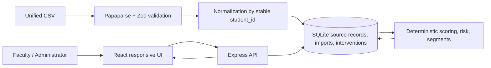

# CampusIQ architecture

## Runtime boundaries

- `src/client` owns view state, loading/error states, filters and HTTP calls. It never accesses SQL.
- `src/server` owns Express routes, validation orchestration and persistence operations.
- `src/db` initializes SQLite constraints and idempotently seeds synthetic data.
- `src/analytics` is pure TypeScript. `calculateScore` accepts a normalized `StudentRecord` and returns a repeatable explanation.
- `src/import` validates the unified CSV before a transaction writes source records.
- `src/shared` contains domain types and methodology metadata shared by API and client.
- `src/auth` contains the authentication boundary: environment mode, demo identity bootstrap, password hashing, opaque sessions, role checks and audit helpers.

## Data lifecycle

1. App startup initializes tables and seeds 54 synthetic records when the database is empty.
2. A CSV is parsed and checked without mutating source data.
3. The validation response stores its accepted normalized rows, header state and row-level errors in the import batch. Commit is therefore not tied to one Node process.
4. Atomic mode requires zero row errors. Partial mode explicitly commits only valid rows.
5. Accepted records upsert on stable `student_id` and `(student_id, observed_at)` domain observations.
6. `refreshSnapshots` recalculates each score, explanation and segment membership.
7. Dashboard/profile routes derive their response from current source rows and deterministic analytics.
8. Intervention updates write the current record and status/note history in SQLite.

## Production boundary

The demo currently runs on SQLite so a fresh clone is easy to evaluate. `DEMO_MODE` controls synthetic seeding and `AUTH_REQUIRED` controls whether API routes require a faculty session. Authentication, institution catalog, membership and audit tables are already present in the schema. Before real student data is used, move these tables and source data to managed Postgres, provision users through a controlled admin flow, and enable `AUTH_REQUIRED=true`.

The validated import payload is staged in SQLite with immutable batch metadata/errors, so a restart or another Node process can complete a preview on the same persistent database. Vercel's default `/tmp` database remains ephemeral; use a persistent disk/database for durable imports and interventions.
